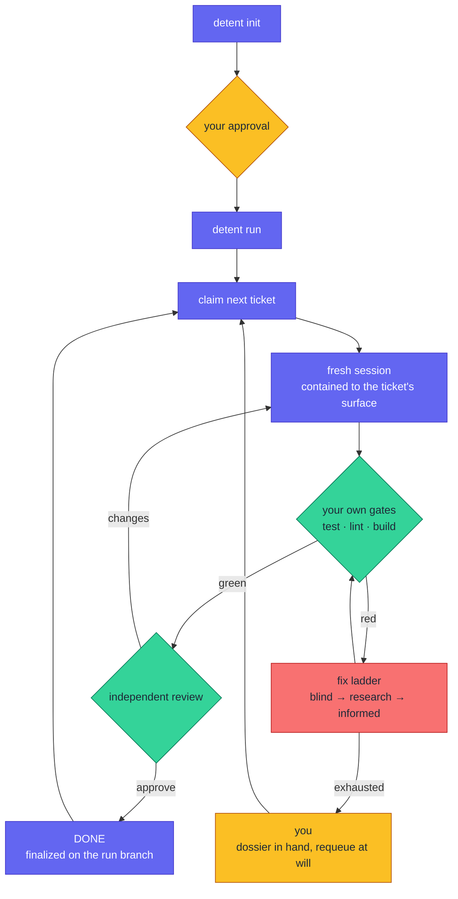

# Detent

[](https://github.com/djazairdev/detent/actions/workflows/ci.yml)
[](https://github.com/djazairdev/detent/releases)
[](LICENSE)
[](.github/workflows/ci.yml)
[](https://github.com/djazairdev/detent/issues?q=is%3Aissue+is%3Aopen+label%3A%22good+first+issue%22)
[](https://github.com/djazairdev/detent/issues?q=is%3Aissue+is%3Aopen+label%3Aenhancement+sort%3Areactions-%2B1-desc)

Detent turns planning documents into merged, reviewed, test-gated code using
fresh, single-purpose Claude Code sessions whose every consequential move is
admitted by a deterministic referee.

Planning tools (spec-kit, Superpowers, BMAD and their peers) write excellent
documents. Those documents are Detent's *input*. Detent is the referee
underneath that layer: it makes the run auditable, budgeted, and contained,
whichever way the plan was written.

- **An auditable state machine**: every admitted transition is journaled to
  `transitions.jsonl`; the run's ground truth is never a chat log.
- **Hard budgets**: attempt and spend ceilings you set yourself; a ceiling
  never auto-retries, it presents a human decision.
- **Verification bound to your project, with drift halts**: Detent executes
  your repo's own test/lint/build commands, and halts for re-baselining if
  they change mid-run.
- **Per-ticket write containment**: a deny-enforced hook holds every session
  inside its ticket's declared surface; allow-rules cannot shadow it.

Detent is held to the standard it enforces: every change to Detent lands
through a pull request that must pass its six checks on Node 22 and 24, and
every release walks [the release checklist](docs/release-checklist.md).

Detent is built and maintained in Algeria, as part of [djazairdev](https://github.com/djazairdev).

## Install

```bash
claude plugin marketplace add djazairdev/detent
```

```bash
claude plugin install detent@detent
```

For development, load the checkout with `claude --plugin-dir /path/to/detent`.
The headless driver is the same referee under a deterministic loop, for CI
and unattended runs.

Using Detent on an existing or a new project, and what it does to your working
tree, is in [docs/using-detent.md](docs/using-detent.md). Releases follow
[docs/release-checklist.md](docs/release-checklist.md).

## The golden path

Two commands. That is the whole public workflow.

```bash
detent init
```

`init` runs eleven phases, in order. On a terminal it asks you DECIDE's questions as it goes; otherwise it stops only where it can't go on without you, and at the end for your approval. Each phase in a sentence:

- **INIT_FS**: checks you're at the root of a git repository and creates the `.detent/` folder.
- **DISCOVER**: finds your planning documents, and the commands that test, lint and build your project.
- **AUDIT**: reads your documents and lists what contradicts itself and what's missing. It checks the claims your decisions rely on, such as how a library behaves at the version you pin, against their sources.
- **DECIDE**: settles what AUDIT left open. It asks you what only you can decide, such as money or contracts, proposes a default for the rest, and records everything in `docs/founder-decisions.md`.
- **WRITE**: rewrites your documents into the *pack*, a standard layout in which every requirement has an id and testable acceptance criteria. Your originals move to `archive/`; nothing is deleted.
- **VALIDATE**: has reviewers check the pack and a writer fix what they find, round after round, until no serious problem is left or 8 rounds have run (the default). A problem it can't fix stops `init` for you.
- **DETERMINE_VERIFICATION**: runs the candidate commands and keeps the ones that work as the *gates* every change must pass.
- **SLICE**: cuts the product into *slices*, small increments that each run, starting with the smallest version that works end to end.
- **PLAN**: turns each slice into *tickets*, small tasks that each name their acceptance criteria, the files they may change and what they wait on. Code checks every ticket, and a reviewer reads each slice's plan.
- **PREPARE_AGENTS**: chooses the role, and the model, for each ticket's sessions.
- **PRESENT**: shows you the plan, the decisions and defaults, the risks left open and what planning cost, then waits for your approval.

[docs/how-it-works.md](docs/how-it-works.md) has each phase in full, with the cost estimates `init` prints and the settings below.

Two settings change how `init` runs, in `.detent/config.json`. `init_sessions_at_once`, under `budgets`, is how many of AUDIT's checks and VALIDATE's reviews run at once (4 by default, 1 to 16). `review_foundations` set to `given` makes each review about 40% cheaper, but it finds less. The default stays `read`: on Detent's review set, reviewers handed the foundations found every blocker but only 113 of its 132 majors, where reviewers reading them found 124.

```bash
detent run
```



`run` takes the next ticket and starts a fresh Claude Code session that may
change only the files the ticket names. Then it runs your project's own
tests, lint and build. When they pass, a separate session reviews the change.
When they fail, Detent tries to fix it, first directly, then after researching
the failure, and hands the ticket to you if nothing works.

Amber is you; indigo is Detent; green is checking; red is fixing. The
*referee*, plain code and not a model, decides every move, and records each one
in `transitions.jsonl`. A limit you set, on attempts or on spending, hands
the ticket to you and is never retried, and a ticket labelled risky waits for your approval before it's
done.

## Models

Every session runs on Claude Opus 5.5 or Claude Sonnet 5.5. `init` writes this
routing to `.detent/config.json`:

| Roles | Model | Effort |
|---|---|---|
| `planner`, `plan_review`, `audit`, `spec_write`, `spec_review` | `claude-opus-5-5` | `max` |
| `review`, `diagnose`, `informed_fix` | `claude-opus-5-5` | `xhigh` |
| `implement`, `blind_fix`, `review_fix`, `research` | `claude-sonnet-5-5` | `xhigh` |

The roles that judge, plan and specify run on Opus; the roles that write code
run on Sonnet. Edit `model_routing` and `effort_routing` in
`.detent/config.json` to change either.

Per-task routing, how a ticket's risk raises these levels, and what happens to
a config an earlier Detent wrote are in
[docs/how-it-works.md](docs/how-it-works.md#models-in-detail).

## What Detent will never do

- Write to your base branch: work happens on a `detent/run-<id>` branch.
- Transition on a claim: only artifacts and exit codes move a ticket forward.
- Redefine a gate mid-run: if a verification command changes in flight,
  Detent halts and asks you to re-baseline.
- Own your tooling: `.detent/` never contains your project's configuration.

## Exit codes

`run` exit codes are public API:

| Code | Meaning |
|---|---|
| `0` | plan complete |
| `10` | human-gated items remain |
| `2` | not ready (no or unapproved plan, binding drift) |
| `1` | error |

## Plumbing

Documented, scriptable, and never required on the golden path:
`detent status`, `detent report`, `detent doctor`, `detent approve <id>`,
`detent requeue <id>`, `detent unclaim <id>`, `detent amend <AM-id>`, `detent verify sync`,
`detent verify lifecycle`.

`detent verify lifecycle` lists the lifecycle scripts a project's manifests declare (`postinstall`,
`prepare`, a gate's `pretest`, and the rest npm runs), each with its body and hash. Detent runs
none of them, until an operator approves a body with `--approve <script>`. A run then executes
that body where npm would have, and an edited body waits for a new approval.

`detent amend <AM-id>` shows an amendment a session filed against the specification pack, and
decides it with `--approve`, `--edit <file>` or `--reject <reason>`. An applied amendment waits for
`detent init`, which re-validates the pack and re-plans the slices it changed.

`detent status` also shows how the plan is running, for the plan and for each
slice: tickets done, and done in their first generation, stops for you,
falsifications by cause, budget breaches, review rounds, cost and time at work,
with the builds that made the plan and its pack; then what `init` spent on each
phase. A run records the same figures in its journal when it ends. They are
evidence for deciding which planning mechanisms stay, and they gate nothing.
`detent status` then counts `run`'s sessions by why each ran at its level:
its role's, raised for its ticket's risk, or raised by evidence, with what each
group cost.
While `init` is in a costly step, `detent status` shows the step, the units done
and left, what they have spent so far, and an estimated finish from the figures
its note gave; after a stop, it shows the step the stop left and how far it got.

## Make your first contribution

1. Pick an issue labelled [good first issue](https://github.com/djazairdev/detent/issues?q=is%3Aissue+is%3Aopen+label%3A%22good+first+issue%22).
2. Comment on it to say you're working on it.
3. Follow [CONTRIBUTING.md](CONTRIBUTING.md) to set up, test and open a pull request, and the rules in [AGENTS.md](AGENTS.md).
4. We reply to newcomers' pull requests within 7 days. A review or a merge may take longer.

You can help without writing code, too: improve the docs, or run Detent on a project of yours and report what went wrong.

## Feedback

- [Ask a question](https://github.com/orgs/djazairdev/discussions/categories/q-a)
- [Report a bug](https://github.com/djazairdev/detent/issues/new?template=bug.yml)
- [Suggest an improvement](https://github.com/djazairdev/detent/issues/new?template=idea.yml), or 👍 the [improvements](https://github.com/djazairdev/detent/issues?q=is%3Aissue+is%3Aopen+label%3Aenhancement+sort%3Areactions-%2B1-desc) you want most
- [Propose a new project](https://github.com/djazairdev/djazair.dev/discussions/categories/ideas) for Algeria
- Follow djazairdev on [Facebook](https://www.facebook.com/djazairdev) and [X](https://x.com/djazairdev) for news

Ask in Arabic, Tamazight, French or English. Code, docs and issue titles are in English, so everyone can search them. Report security problems [privately](https://github.com/djazairdev/detent/security/policy), never in an issue.

## License

[MIT](LICENSE).

---

Part of [djazairdev](https://github.com/djazairdev): growing Algeria's open-source community through useful projects, welcoming first contributions and collaboration. Find more projects in the [djazair.dev Hub](https://djazair.dev/en/hub/). Everyone follows our [code of conduct](https://github.com/djazairdev/.github/blob/main/CODE_OF_CONDUCT.md).
