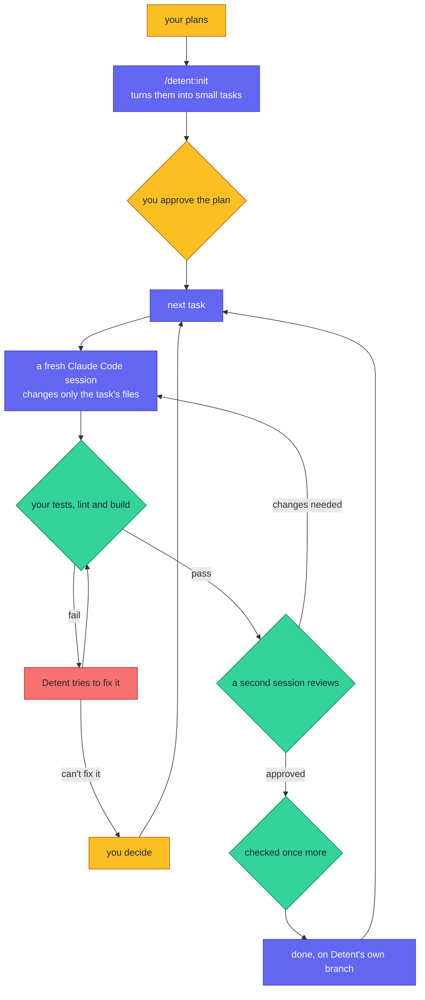

# Detent

[](https://github.com/djazairdev/detent/actions/workflows/ci.yml)
[](https://github.com/djazairdev/detent/releases)
[](LICENSE)
[](.github/workflows/ci.yml)
[](https://github.com/djazairdev/detent/issues?q=is%3Aissue+is%3Aopen+label%3A%22good+first+issue%22)
[](https://github.com/djazairdev/detent/issues?q=is%3Aissue+is%3Aopen+label%3Aenhancement+sort%3Areactions-%2B1-desc)

Detent builds software from your plans with Claude Code, and keeps the AI on a
short leash.

You write down what you want built: a spec, a PRD, or a plan from a tool like
spec-kit, Superpowers or BMAD. Detent turns it into small tasks and has Claude
Code do them one at a time. You approve the plan before anything starts. Each
task gets a fresh session, your project's own tests decide whether it worked,
and a second session reviews the work before it counts. When Detent can't fix
something itself, it stops and hands it to you.



Amber is you; indigo is Detent; green is checking; red is fixing. The full
loop, with every case, is in [docs/golden-path.md](docs/golden-path.md).

Every step is decided by a *referee*: plain code, not an AI. That's what makes
it different from letting an agent run on its own:

- **You can see everything it did.** Every step is written to a log file you
  can read, not buried in a chat.
- **It can't overspend.** You set limits on attempts and money. When one is
  reached, Detent stops and asks you instead of trying again.
- **Your tests are the judge.** It runs your project's own test, lint and build
  commands, and stops if they change during a run.
- **It stays in its lane.** Each session can only change the files its task
  names, and no permission setting can override that.

Detent is held to the standard it enforces: every change to Detent lands
through a pull request that must pass its six checks on Node 22 and 24, and
every release walks [the release checklist](docs/release-checklist.md).

Detent is built and maintained in Algeria, as part of [djazairdev](https://github.com/djazairdev).

## Quick start

You need [Claude Code](https://docs.claude.com/en/docs/claude-code) and
Node.js 22 or later. Sessions run on your Claude login, or on an API key in
`ANTHROPIC_API_KEY`, and spend its usage: `init` estimates the cost of each
costly step before it starts.

1. Install the plugin:

   ```bash
   claude plugin marketplace add djazairdev/detent
   claude plugin install detent@detent
   ```

2. Open Claude Code at the root of your project's git repository, and plan the
   work from your planning documents:

   ```
   /detent:init
   ```

   Detent checks your documents, settles what they leave open with defaults
   you can veto, and shows you the plan for approval.

3. Run the approved plan:

   ```
   /detent:run
   ```

   Each ticket is built in a fresh session, tested with your project's own
   commands and reviewed, on a `detent/run-<id>` branch. Your base branch is
   never touched.

What each step does is in [docs/golden-path.md](docs/golden-path.md). Using
Detent on an existing or a new project, and what it does to your working tree,
is in [docs/using-detent.md](docs/using-detent.md). The models it runs, its exit
codes and the plumbing commands are in [docs/reference.md](docs/reference.md).

## What Detent will never do

- Write to your base branch: work happens on a `detent/run-<id>` branch.
- Transition on a claim: only artifacts and exit codes move a ticket forward.
- Redefine a gate mid-run: if a verification command changes in flight,
  Detent halts and asks you to re-baseline.
- Own your tooling: `.detent/` never contains your project's configuration.

## Make your first contribution

1. Pick an issue labelled [good first issue](https://github.com/djazairdev/detent/issues?q=is%3Aissue+is%3Aopen+label%3A%22good+first+issue%22).
2. Comment on it to say you're working on it.
3. Follow [CONTRIBUTING.md](CONTRIBUTING.md) to set up, test and open a pull request, and the rules in [AGENTS.md](AGENTS.md).
4. We reply to newcomers' pull requests within 7 days. A review or a merge may take longer.

You can help without writing code, too: improve the docs, or run Detent on a project of yours and report what went wrong.

## Feedback

- [Ask a question](https://github.com/orgs/djazairdev/discussions/categories/q-a)
- [Report a bug](https://github.com/djazairdev/detent/issues/new?template=bug.yml)
- [Suggest an improvement](https://github.com/djazairdev/detent/issues/new?template=idea.yml), or 👍 the [improvements](https://github.com/djazairdev/detent/issues?q=is%3Aissue+is%3Aopen+label%3Aenhancement+sort%3Areactions-%2B1-desc) you want most
- [Propose a new project](https://github.com/djazairdev/djazair.dev/discussions/categories/ideas) for Algeria
- Follow djazairdev on [Facebook](https://www.facebook.com/djazairdev) and [X](https://x.com/djazairdev) for news

Ask in Arabic, Tamazight, French or English. Code, docs and issue titles are in English, so everyone can search them. Report security problems [privately](https://github.com/djazairdev/detent/security/policy), never in an issue.

## License

[MIT](LICENSE).

---

Part of [djazairdev](https://github.com/djazairdev): growing Algeria's open-source community through useful projects, welcoming first contributions and collaboration. Find more projects in the [djazair.dev Hub](https://djazair.dev/en/hub/). Everyone follows our [code of conduct](https://github.com/djazairdev/.github/blob/main/CODE_OF_CONDUCT.md).
