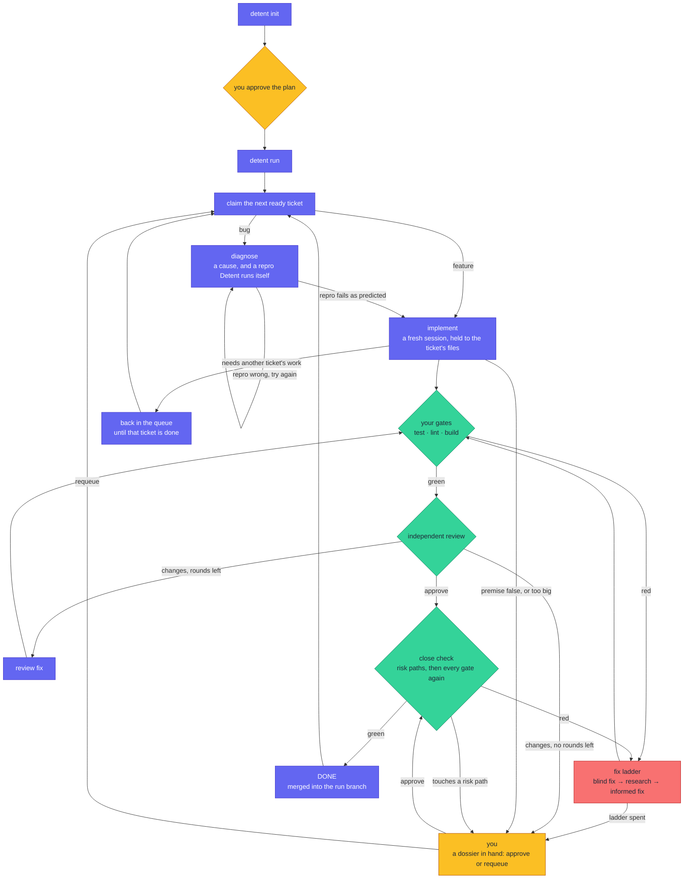

# The golden path

Two commands. That is the whole public workflow: `detent init` plans the work,
and `detent run` carries out the plan you approved.

In Claude Code they are `/detent:init` and `/detent:run`. The same referee also
runs headless, as a deterministic loop, for CI and unattended runs.

```bash
detent init
```

`init` runs eleven phases, in order. On a terminal it asks you DECIDE's questions as it goes; otherwise it stops only where it can't go on without you, and at the end for your approval. Each phase in a sentence:

- **INIT_FS**: checks you're at the root of a git repository and creates the `.detent/` folder.
- **DISCOVER**: finds your planning documents, and the commands that test, lint and build your project.
- **AUDIT**: reads your documents and lists what contradicts itself and what's missing. It checks the claims your decisions rely on, such as how a library behaves at the version you pin, against their sources.
- **DECIDE**: settles what AUDIT left open. It asks you what only you can decide, such as money or contracts, proposes a default for the rest, and records everything in `docs/founder-decisions.md`.
- **WRITE**: rewrites your documents into the *pack*, a standard layout in which every requirement has an id and testable acceptance criteria. Your originals move to `archive/`; nothing is deleted.
- **VALIDATE**: has reviewers check the pack and a writer fix what they find, round after round, until no serious problem is left or 8 rounds have run (the default). A problem it can't fix stops `init` for you.
- **DETERMINE_VERIFICATION**: runs the candidate commands and keeps the ones that work as the *gates* every change must pass.
- **SLICE**: cuts the product into *slices*, small increments that each run, starting with the smallest version that works end to end.
- **PLAN**: turns each slice into *tickets*, small tasks that each name their acceptance criteria, the files they may change and what they wait on. Code checks every ticket, and a reviewer reads each slice's plan.
- **PREPARE_AGENTS**: chooses the role, and the model, for each ticket's sessions.
- **PRESENT**: shows you the plan, the decisions and defaults, the risks left open and what planning cost, then waits for your approval.

[how-it-works.md](how-it-works.md) has each phase in full, with the cost estimates `init` prints and the settings below.

Two settings change how `init` runs, in `.detent/config.json`. `init_sessions_at_once`, under `budgets`, is how many of AUDIT's checks and VALIDATE's reviews run at once (4 by default, 1 to 16). `review_foundations` set to `given` makes each review about 40% cheaper, but it finds less. The default stays `read`: on Detent's review set, reviewers handed the foundations found every blocker but only 113 of its 132 majors, where reviewers reading them found 124.

```bash
detent run
```



`run` takes the next ticket whose dependencies are done, and starts a fresh
Claude Code session that may change only the files the ticket names. A bug
ticket starts with a diagnosis: a session proposes the cause and a repro,
Detent runs the repro itself, and the fix starts only once it fails as
predicted.

Then Detent runs your project's own tests, lint and build. When they pass, a
separate session reviews the change, and the changes it asks for buy a set
number of review-fix rounds. When they fail, Detent climbs the fix ladder: a
second attempt, then a session that researches the failure, then a fix informed
by that research.

Before a ticket is done, the close check asks for your approval if the change
touches a path you listed as risky (`risk` in `.detent/config.json`), then runs
every gate again. The ticket is then merged into the run branch.

A session can also stop on what it finds. A ticket that needs another ticket's
work goes back in the queue until that work is done. A false premise, or a
ticket too big for one session, comes to you.

Amber is you; indigo is Detent; green is checking; red is fixing. The
*referee*, plain code and not a model, decides every move, and records each one
in `transitions.jsonl`. At any step, a limit you set, on attempts or on
spending, hands the ticket to you and is never retried. A gate command that
changes mid-run blocks the ticket until you re-baseline it with
`detent verify sync` and requeue it.
